# AmbientModules — User Manual

I wanted to recreate in VCV Rack / Cardinal some performances I had seen on YouTube played on the SOLAR 42F. Having tried with existing modules first, I built this collection instead: to save CPU, to make the SOLAR 42F's sections modular enough that you only use what you need, and to pay tribute to the synth's distinctive graphic style.

The modules try to stay as faithful to the hardware as possible. As far as I know, Elta Music doesn't publish any technical reference describing exactly what each section does and how, so this fidelity is built from the SOLAR 42F user manual and from demo videos of the real instrument.

**AmbientModules** is a collection of VCV Rack / Cardinal modules inspired by the [Elta Music](https://www.eltamusic.com) [ **SOLAR 42F** "Ambient Drone Machine"](https://www.eltamusic.com/solar-42f)  — an analog microtonal drone synthesizer. Rather than reproducing the SOLAR 42F's fixed hardware layout, each of its sound engines is broken out here into an independent, freely-patchable Rack module:

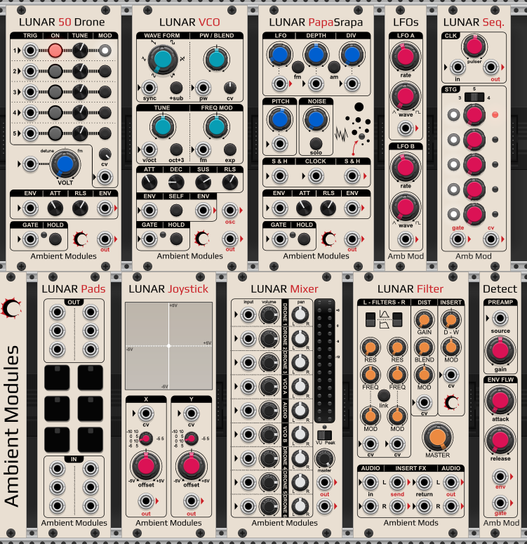

| Module                            | What it does                                       | SOLAR 42F equivalent                       |
|-----------------------------------|----------------------------------------------------|--------------------------------------------|
| [Blank](#blank)                   | Blank panel                                        | —                                          |
| [Lunar50Drone](#lunar50drone)     | 5-oscillator sawtooth drone with a shared envelope | Drone voices 1, 2, 4, 5 "Classic Solar 50" |
| [LunarVCO](#lunarvco)             | AS3340-style VCO with ADSR and hard sync           | Voices "VCO A / VCO B"                     |
| [LunarPapaSrapa](#lunarpapasrapa) | FM/AM cross-modulated noise/drone voice            | Drone voices 3, 6 "Papa Srapa"             |
| [LunarLFO](#lunarlfo)             | Dual triangle/square LFO                  | LFOs (Unipolar)                                       |
| [LunarSequencer](#lunarsequencer) | 3-to-5-stage Buchla-inspired CV/gate sequencer     | Sequencer                                  |
| [LunarMixer](#lunarmixer)         | 9-channel panoramic mixer with master level        | Mixer page                                 |
| [LunarFilter](#lunarfilter)       | Dual 12dB Polivoks-style multimode filter + distortion | Filter block                          |
| [LunarJoystick](#lunarjoystick)   | Draggable XY pad / CV position source, per-axis range + offset | Joystick block                  |
| [LunarPads](#lunarpads)           | 6-pad momentary/latching gate source for the drone voices | "DRONE KEYS" pushbutton grid        |
| [LunarDetector](#lunardetector)   | External-source preamp with envelope follower + gate detector | Contact mic + Envelope follower block |

## Table of Contents

- [Videos](#videos)
- [Solar 42f patch](#solar-42f-patch)
- [Panel themes](#panel-themes)
- [Right-click menu](#right-click-menu)
- [Shared conventions](#shared-conventions)
- [Modules](#modules)
  - [Blank](#blank)
  - [Lunar50Drone](#lunar50drone)
  - [LunarVCO](#lunarvco)
  - [LunarPapaSrapa](#lunarpapasrapa)
  - [LunarLFO](#lunarlfo)
  - [LunarSequencer](#lunarsequencer)
  - [LunarMixer](#lunarmixer)
  - [LunarFilter](#lunarfilter)
  - [LunarJoystick](#lunarjoystick)
  - [LunarPads](#lunarpads)
  - [LunarDetector](#lunardetector)
- [Building and testing](#building-and-testing)
- [AI disclosure](#ai-disclosure)

## Videos

- [🎬 LunarPlusTwelve Challenge 2026 - Patch A (NeilBgr)](https://www.youtube.com/watch?v=siYU6xWeEf8) 
  - A live-played patch built and performed for the  [🏆 LunarPlusTwelve Challenge (November 2026)](https://community.vcvrack.com/t/lunarplustwelve-challenge-november-2026/26291) on the VCV Rack community forum
  - 📥 Download the [patch from Patchstorage](https://patchstorage.com/lunarplustwelve-challenge-2026/)
  - [🔍 View its diagram in VCV Patch Tools](https://neilbgr.github.io/VcvPatchTools/?url=https://patchstorage.com/wp-content/uploads/2026/11/LunarPlusTwelve_NeilBgr-PatchA-v1-6ae79aec80edd.rack_.vcv&name=LunarPlusTwelve_NeilBgr-PatchA-v1.vcv)
- [🎬 Free Solar 42 inspired modules and setup in VCV Rack - Omri Cohen](https://www.youtube.com/watch?v=m5tixV10dI8)
- [🎬 Lunar 42 VCV Rack modules - Cinematic performance](https://youtu.be/Ja0lZwwcWLM)
  - A live patch using Lunar50Drone, LunarVCO, and LunarLFO
  - Inspired by [🎬 JayHosking's original "Solar 42F synth - Cinematic performance"](https://www.youtube.com/watch?v=wQyHPJ56aNg)
  - 📥 Download the [VCV-Rack patch file](patches/Solar42f-Cinematic-Performance.vcv)
  - [🔍 View its diagram in VCV Patch Tools](https://neilbgr.github.io/VcvPatchTools/?url=https://github.com/neilbgr/AmbientModules/blob/main/patches/Solar42f-Cinematic-Performance.vcv)
- [🎬 Lunar 42 VCV Rack modules - Cinematic Ambient](https://youtu.be/l4NEwDLc4YI)
  - A live patch using Lunar50Drone, LunarVCO, LunarLFO, and LunarSequencer; inspired by [🎬 JayHosking's original "Cinematic Ambient (part 1)"](https://www.youtube.com/watch?v=45tY-e7fdm4)
- [🎬 "Meditation on Death - Jay Hoskin" - VCV-Rack/Cardinal version](https://youtu.be/0JBJCdcSywY)
  - A live patch inspired by [🎬 JayHosking's original MEDITATIONS ON DEATH | Solar 42F, Vongon Replay, Intellijel Swells & Jellymix, Fieldtone Weaver](https://www.youtube.com/watch?v=jW-JyjP6m4g)
  - 📥 Download the [VCV-Rack patch file](patches/Meditations-on-Death.vcv)
  - [🔍 View its diagram in VCV Patch Tools](https://neilbgr.github.io/VcvPatchTools/?url=https://github.com/neilbgr/AmbientModules/blob/main/patches/Meditations-on-Death.vcv)

## Solar 42f patch

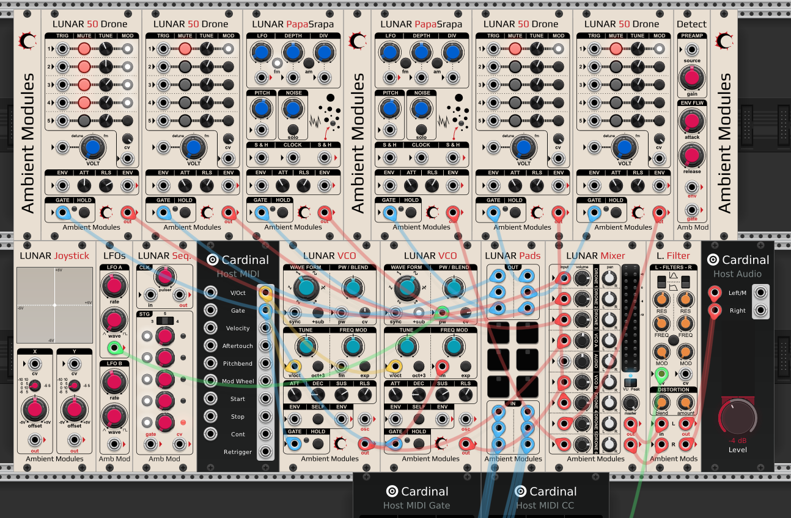

[**Solar42-patch.vcv**](patches/Solar42-patch.vcv) — a full-rack patch reassembling the SOLAR 42F's own architecture out of these modules: 4× Lunar50Drone (Drone 1/2/4/5, Oscillator mix set to *Fixed sum / 5 (legacy)* to match the real hardware's mixing) and 2× LunarPapaSrapa (Drone 3/6) gated from LunarPads, 2× LunarVCO (VCO A/B, cross-modulating each other's FM and both driven from the same MIDI keyboard), all summed through LunarMixer and into LunarFilter (Filter L's cutoff modulated by a LunarLFO, Filter R's by a MIDI CC) before audio output, plus LunarSequencer/LunarLFO/LunarJoystick for modulation and an unpatched LunarDetector included alongside for reference. Uses Rack's own core MIDI-CV/Audio modules (not Cardinal-specific ones), so it opens equally well in standalone VCV Rack or in Cardinal (drag the file onto the window, or File → Open) — a patch saved from Cardinal using its own Host MIDI/Audio modules would only open back in Cardinal, not standalone Rack.

[View the patch's diagram in VCV Patch Tools](https://neilbgr.github.io/VcvPatchTools/?url=https://github.com/neilbgr/AmbientModules/blob/main/patches/Solar42-patch.vcv), a web app that draws what a VCV Rack or Cardinal patch does, right in the browser.

## Panel themes

Every AmbientModules panel is available in 5 color themes: **Cream** (default — used for every screenshot in this manual), **Black**, **Pink**, **Yellow**, and **Blue**. Theme is a single pack-wide setting, not per-module: changing it from any one module's right-click menu (see below) instantly re-themes every AmbientModules module already in the patch, and every new one you add afterward starts in that same theme too — it's remembered between sessions.

The full rack of AmbientModules modules, side by side, in each of the 5 available themes:

### Cream


### Black

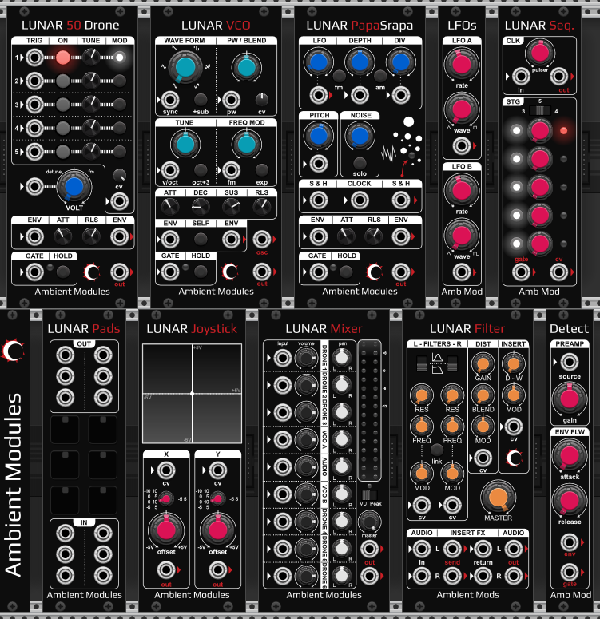

### Pink

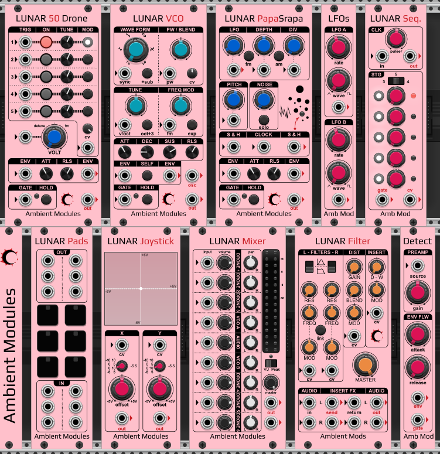

### Yellow

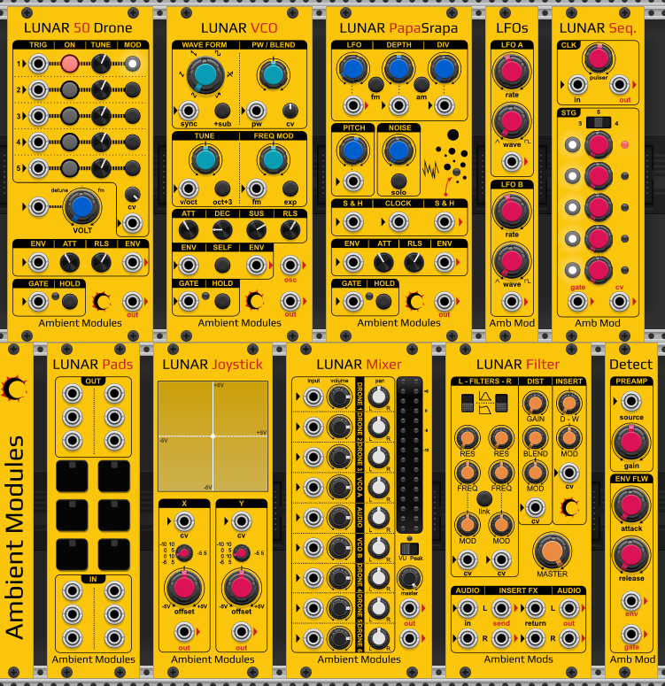

### Blue

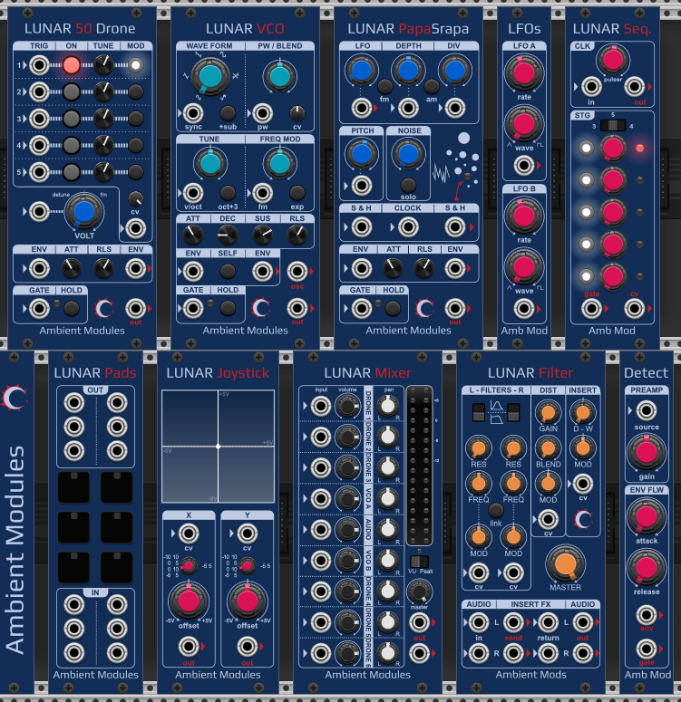

## Right-click menu

Right-click any AmbientModules module to open its context menu. One entry is identical across all 9 modules:

- **Theme**
  - A submenu to switch the pack-wide panel theme between Cream / Black / Pink / Yellow / Blue.
  - It's not specific to the module you right-clicked (see [Panel themes](#panel-themes) above).

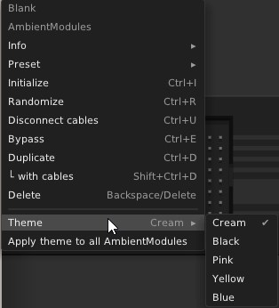

Some modules add extra entries of their own — those are documented under the module in question ([Lunar50Drone](#lunar50drone-context-menu), [LunarLFO](#lunarlfo-context-menu), [LunarSequencer](#lunarsequencer-context-menu), [LunarMixer](#lunarmixer-context-menu), [LunarPads](#lunarpads-context-menu), [LunarFilter](#lunarfilter-context-menu)). LunarVCO, LunarPapaSrapa, LunarJoystick, LunarDetector, and Blank have no module-specific entries.

## Shared conventions

A few behaviors repeat across several modules and are only explained here:

- **V/OCT**
  - Pitch inputs follow the standard 1 volt per octave convention (0V = C4), like any other Rack oscillator.
- **Polyphony**
  - Lunar50Drone, LunarVCO, and LunarPapaSrapa are polyphonic.
  - Every CV input on their main panel is read independently per channel, not just V/OCT and Gate:
    - Lunar50Drone: also Volt CV.
    - LunarVCO: also FM, Shape CV, and Sync.
    - LunarPapaSrapa: also Modulation depth CV and Divider CV.
  - The module's channel count follows whichever of those inputs carries the most channels, or the Envelope CV input if that's higher still.
  - So patching a polyphonic V/OCT or Gate signal (from a polyphonic sequencer, MIDI-to-CV, etc.) into any of those inputs, or chaining another module's polyphonic Envelope output into Envelope CV, drives independent voices per channel throughout the module.
- **Band-limited oscillators**
  - Lunar50Drone, LunarVCO, and LunarPapaSrapa correct every hard edge and corner of their waveforms, to keep digital aliasing low at a small CPU cost.
  - Lunar50Drone and LunarPapaSrapa use PolyBLEP.
  - LunarVCO uses a minimum-phase BLEP (the same as VCV's Fundamental VCO) on every hard edge (Square, including under pulse-width modulation, the saws, the sub and hard sync), and a 4-point PolyBLAMP on the corners of Triangle and Saw to inverted saw. Near its sawtooth ends, where one ramp of Saw to inverted saw gets only a couple of samples long, that ramp is band-limited as an edge instead. Its output comes out 3 samples late (62 µs at 48 kHz) for this (OSC Out, the raw phase, isn't delayed).
  - All three oscillators stop at 20 kHz (or 0.45 × the sample rate, below 44.4 kHz), however much CV or FM is applied.
  - Very deep audio-rate FM can still alias a little on the brighter waveforms.
- **Envelope CV override**
  - Lunar50Drone, LunarVCO, and LunarPapaSrapa each have an **Envelope CV** input.
  - When it's patched, it completely replaces that module's internal envelope, its Gate input, and its Hold switch.
  - Handy for driving several of these modules from one shared envelope, so their amplitudes stay locked together.
- **Hold**
  - Also shared by those same three modules: a **Hold** switch that, when engaged, forces the envelope open permanently (an "always on" drone).
  - Same effect as holding the Gate input high.
  - Overridden the moment the Envelope CV input is patched.

## Modules

### Blank


An empty panel with no parameters, inputs, or outputs — a spacer/template module, not a functional sound source.
### Lunar50Drone

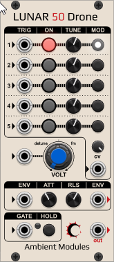

For chords that are more or less rich, and more or less dissonant. It also works as a ready-to-use VCO, with pitch modulation, a volume envelope and a built-in VCA. For dark ambient sounds, the **Volt** knob gives interesting distortions: detuning down towards the low end, and even FM.

Five simple sawtooth oscillators sharing one output and one envelope — the Classic Solar 50 drone voice. Each of the 5 oscillators can be switched on or off independently to build chords and triads, and the **Volt** knob detunes and then cross-modulates them together for FM-style drone textures, exactly as on the original hardware.

🎛️ **Knobs & switches**
- **Oscillator 1–5 active** (lit button, labeled **ON** on the panel; **MUTE** on the hardware)
  - Lit = that oscillator is sounding, unlit = muted.
  - Can also be toggled from the corresponding trigger input.
  - Not polyphonic: a single on/off state per oscillator, shared identically by every poly channel. There's no per-channel "active" state.
  - Oscillator 1 defaults to active, the other four to inactive, so a freshly-added module produces sound immediately instead of silence.
- **Oscillator 1–5 frequency**
  - One knob per oscillator, octave-linear tuning centered on C4.
- **Oscillator 1–5 modulation** (lit button)
  - When lit, that oscillator's pitch follows the **Frequency CV** input (scaled by the CV Attenuverter).
  - When unlit, it ignores Frequency CV.
  - It doesn't affect the Volt cross-modulation, which involves every active oscillator.
  - Oscillator 1 defaults to on, the other four to off.
- **CV Attenuverter**
  - Scales the incoming Frequency CV (±100%, defaults to +100%) before it's applied to every oscillator whose **Modulation** button is lit.
  - So it shifts their combined pitch while preserving the intervals between them.

> [!IMPORTANT]
> Following the real SOLAR 42F, an oscillator only responds to Frequency CV once its own **Modulation** button is enabled.
> - With the attenuverter at its default +100%, enabling Modulation on an oscillator is normally enough on its own.
> - Turn the attenuverter down (or all the way to 0%) to reduce or fully disable Frequency CV's effect on every oscillator at once.
> - This is by design, not a bug: it mirrors the original hardware's per-oscillator "modulation enable" switch.

- **Volt**
  - Transposes all 5 oscillators down together, independently of the Modulation buttons/CV Attenuverter above.
  - Past roughly the halfway point of the knob's travel, they also start frequency-modulating each other, for the same FM synthesis effect described in the original SOLAR 42F documentation.
  - See [Context menu](#lunar50drone-context-menu) for how that cross-modulation is wired.
- **Attack / Release**
  - The shared envelope applied to the mix.
- **Hold** (lit button)
  - See [Shared conventions](#shared-conventions).

📥 **Inputs**
- **Oscillator 1–5 trigger**
  - Toggles the corresponding oscillator's Active state on a rising edge.
  - Monophonic (channel 1 only, even from a polyphonic cable), matching the Active button it drives, which isn't per-channel either.
- **Frequency CV**
  - Sums (through the CV Attenuverter) onto every oscillator whose **Modulation** button is lit.
- **Volt CV**
  - 0–10V, adds to the Volt knob.
  - Polyphonic, read independently per channel.
- **Envelope CV**
  - See [Shared conventions](#shared-conventions).
- **Gate**
  - Opens the shared envelope while high (ignored if Hold is engaged or Envelope CV is patched).

📤 **Outputs**
- **Envelope**
  - 0–10V copy of the envelope currently shaping the mix.
- **Sawtooth mix**
  - The combined, enveloped audio output.

💡 **LEDs**
- **Envelope** (yellow, standalone)
  - Brightness follows the envelope's current level, so it glows brighter as the drone swells and dims as it releases.

<a id="lunar50drone-context-menu"></a>
🖱️ **Context menu**
- **FM topology**
  - How the "Modulation"-enabled oscillators cross-modulate once the Volt knob passes its midpoint:
    - *Average of active others*: each modulated oscillator is pushed by the average of the other active oscillators.
    - *Circular chain*: each one modulates the next in a loop.
- **Oscillator mix**
  - How the 5 oscillator signals combine into the output level:
    - *Fixed sum / 5 (legacy)*: always divides by 5, so muting oscillators lowers the volume.
    - *Average of active oscillators*: keeps output level constant regardless of how many oscillators are active.
    - *Soft-clip saturated sum*: sums them and soft-clips, for a driven, denser tone.
    - *2/3/4 oscillators max*: a fixed divisor, like the legacy mode but calibrated for that many active oscillators, so 2/3/4 oscillators driven hard hit full level without needing all 5 active.

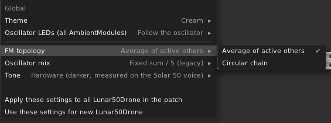 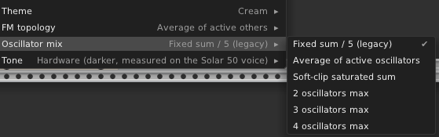

> [!TIP]
> **Patch ideas**
> - Patch a slow [LunarLFO](#lunarlfo) into the Frequency CV input for a slowly drifting drone pitch.
> - Chain several Lunar50Drone (or other envelope-override-capable modules) together by feeding one's Envelope output into the next's Envelope CV input, so an entire stack of drones swells and releases in unison.

### LunarVCO

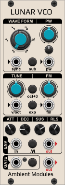

A complete VCO, with pitch modulation, an amplitude envelope, a built-in VCA and many waveforms, often used for melodic leads. Often paired with a second, slightly detuned instance; add the optional sub oscillator and you get rich sounds and very different textures.

An AS3340-style voltage-controlled oscillator — the SOLAR 42F's "VCO A / VCO B" voice — with 6 waveforms, hard sync, linear or exponential FM, and a full ADSR envelope built in.

🎛️ **Knobs & switches**
- **Waveform**
  - 6 positions:
    - Sine, Triangle, Inverted saw, Square.
    - Saw-to-inverted-saw and Sine-to-saw, both morphed by Shape.
- **Sub oscillator** (lit button)
  - Adds a sub-oscillator one octave below (below the base pitch: Oct +3 moves the main only).
  - As on the hardware, it divides the main: its edges always fall on the main's cycle start, so main and sub always mix the same way, whenever the sub is switched on.
  - Its square has sharp edges at any pitch, as on the hardware (measured on Elta's demo video).
- **Shape**
  - Pulse width (square) or morph blend (the two morphing waveforms), plus its CV amount attenuverter.
  - As on the hardware, the pulse vanishes with Shape fully clockwise (or fully counter-clockwise), leaving only the sub when it's on. No click and no DC offset on the way.
- **Tune**
  - ±0.5 octave fine tune.
- **Octave** (lit button)
  - Low or +3 octaves.
- **FM mode** (lit button)
  - Linear or Exponential FM response for the FM input.
  - Linear FM is through-zero: deep modulation that pulls the frequency below 0 Hz runs the oscillator backwards instead of stalling it.
  - So the pitch stays put and the sidebands stay clean at any depth.
- **FM amount**
  - Attenuverter for the FM input.
- **Attack / Decay / Sustain / Release**
  - The built-in ADSR envelope.
- **Self-generation** (lit button)
  - Turns the envelope generator into a free-running LFO instead of a one-shot envelope, cycling Attack/Release only (Decay is skipped).
  - Attack and Release should be turned low (towards 9 o'clock) for this to cycle usefully.
  - Sustain sets its peak depth.
  - Still needs Gate to have gone high at least once (or Hold engaged) to start: it doesn't cycle on its own from silence.
- **Hold** (lit button)
  - See [Shared conventions](#shared-conventions).

📥 **Inputs**
- **Sync**
  - Hard-syncs the oscillator's phase to the incoming signal.
  - Each restart also steps the sub's divider, like the end of a cycle.
- **Shape CV**
  - Modulates the Shape knob, scaled by its attenuverter.
- **V/oct**
  - Pitch, standard 1V/octave.
- **FM**
  - Linear or exponential frequency modulation (mode set by the FM mode switch), scaled by the FM amount knob.
- **Envelope CV**
  - See [Shared conventions](#shared-conventions).
- **Gate**
  - Opens the ADSR envelope while high (ignored if Hold is engaged or Envelope CV is patched).

📤 **Outputs**
- **Envelope Out**
  - 0–10V copy of the ADSR currently shaping Audio Out.
- **OSC Out**
  - Raw, unenveloped oscillator phase (±5V ramp).
  - Mirrors the hardware's VCO B "OSC" output.
  - Patch it into another LunarVCO's Sync input to hard-sync that oscillator to this one.
- **Audio Out**
  - The enveloped (VCA'd) oscillator signal.

💡 **LEDs**
- **Envelope** (yellow, standalone)
  - Brightness follows the ADSR's current level, glowing brighter through Attack/Sustain and dimming through Decay/Release.

> [!TIP]
> **Patch ideas**
> - Drive V/oct from [LunarSequencer](#lunarsequencer)'s Step CV output for melodic drone runs.
> - Enable Self-generation with a slow Attack/Release and Hold engaged to use the envelope itself as a free amplitude LFO with nothing patched into Gate.
> - Two LunarVCOs, A and B: patch B's OSC Out into A's Sync input for a classic hard-sync timbre — detune A against B and sweep A's Tune/FM for the sync "sweep" sound.

### LunarPapaSrapa

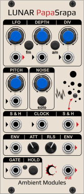

A VCO with a very strong character: you get the best out of it by pushing it to its limits. I use it for bass sounds as much as for two-tone sirens. Its S&H and noise sections are an extra source of surprises, ready to be patched into anything else.

The SOLAR 42F's "Papa Srapa" noise/drone voice: a low-frequency square-wave modulator cross-modulating an audio-rate square oscillator (FM and/or AM), blended with independent white noise, plus a built-in sample & hold and envelope.

🎛️ **Knobs & switches**
- **LFO**
  - The modulator's frequency, from 1Hz up to ~C4.
- **fm** (lit button)
  - Routes the modulator into the audio oscillator's frequency.
- **Modulation depth**
  - How strongly the modulator affects the audio oscillator, plus its CV input.
- **am** (lit button)
  - Routes the modulator into the audio oscillator's amplitude.
  - FM and AM can be enabled together.
- **Divider**
  - Divides down the modulator's frequency relative to the audio oscillator, plus its CV input.
- **Pitch**
  - The audio oscillator's pitch, spanning C0 to E7.
- **Noise**
  - Mix level of the internal white noise source.
  - Each polyphonic voice, and each module instance, gets its own uncorrelated noise.
  - Freshly seeded every time the module is created or the patch is loaded.
- **Noise only** (lit button)
  - Forces a clean white-noise-only output, overriding Pitch/FM/AM/Divider.
- **Attack / Release**
  - The shared envelope.
- **Hold** (lit button)
  - See [Shared conventions](#shared-conventions).

📥 **Inputs**
- **Modulation depth CV**, **Divider CV**
  - Sum onto their respective knobs.
  - Polyphonic, read independently per channel, each driving its own per-channel modulator (see LFO output below).
  - So different channels can have their own FM/AM depth and modulator rate.
- **Pitch CV**
  - 1V/oct, sums onto the Pitch knob.
- **Sample & hold input**
  - The source to sample.
  - Normalled to the internal noise generator when nothing is patched here: its own random sequence per channel and per module instance, different on every patch load.
  - Polyphonic, same channel count as Sample & hold clock.
- **Sample & hold clock**
  - Samples a new value on each rising edge.
  - Polyphonic, with its own channel count driven by Sample & hold clock/input, independent from the rest of the panel (see Outputs below).
- **Envelope CV**
  - See [Shared conventions](#shared-conventions).
- **Gate**
  - Opens the envelope while high (ignored if Hold is engaged or Envelope CV is patched).

📤 **Outputs**
- **LFO**
  - The raw low-frequency modulator signal, always running while patched.
  - Polyphonic: each channel gets its own independent modulator (see Modulation depth CV / Divider CV above), unlike the real hardware's single LFO per module.
- **Sample & hold**
  - The current sampled value.
  - Polyphonic, with its own channel count driven by the Sample & hold Signal/Clock inputs.
  - Independent from Pitch CV/Gate/Envelope CV, since S&H is a self-contained section of the panel.
- **Envelope**
  - 0–10V copy of the envelope currently shaping VCO Out.
- **VCO (enveloped)**
  - The main cross-modulated/noise audio output, shaped by the envelope.

💡 **LEDs**
- **Sample & Hold** (blue, standalone)
  - Flashes with each new sample on channel 1.
  - Brightness proportional to that channel's sampled value's magnitude (a single LED can't show all channels at once).
- **Envelope** (yellow, standalone)
  - Brightness follows the envelope's current level.

> [!TIP]
> **Patch ideas**
> - Turn on both FM and AM with a fast Rate and high Modulation depth for the "sirens and space monsters" sounds the original Papa Srapa circuit is known for.
> - Patch [LunarSequencer](#lunarsequencer)'s Clock Out into Sample & hold clock to resample the internal noise once per step, for a random stepped CV source.

### LunarLFO

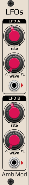

Often used to make a patch breathe and come alive, by slowly modulating the filter cutoff with one of its outputs. It can of course modulate anything you like, and even serve as a clock using its square waveform.

Two independent, unipolar (by default) LFOs — LFO A and LFO B — each blending continuously between a triangle and a square wave.

🎛️ **Knobs**
- **LFO A / B rate**
  - Octave-spaced rate knobs, one per LFO.
- **LFO A / B wave**
  - Morphs that LFO's shape between triangle and square.

**Inputs:** none.

📤 **Outputs**
- **LFO A** / **LFO B**
  - Each only runs while its output is patched (idle and reset to phase 0 otherwise).
  - Voltage range set by CV Range below.

<a id="lunarlfo-context-menu"></a>
🖱️ **Context menu**
- **CV Range**
  - Sets the output range shared by both LFO A and B:
    - *0V to +5V* (default, matches the SOLAR 42F hardware).
    - *0V to +10V*, *-5V to +5V*, or *-10V to +10V*.

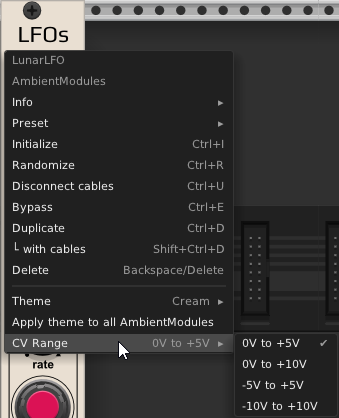

> [!TIP]
> **Patch ideas**
> - Patch LFO A into [Lunar50Drone](#lunar50drone)'s Frequency CV, or into [LunarVCO](#lunarvco)'s Shape CV, for slow evolving drone movement.
> - Set CV Range to a bipolar range and use LFO B to pan or crossfade elsewhere in the patch.

### LunarSequencer

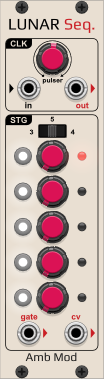

Creativity born from constraints: this sequencer, modelled on the SOLAR 42F's Buchla-style 3-to-5-stage sequencer, has no reset, no run/stop, and its knobs show voltages, not pitches... So it's up to you to bring it to life!

A classic, Buchla-inspired 3-to-5-stage sequential voltage source: each step stores its own CV (0–100%, rescaled to volts by the CV Range setting) and its own gate on/off.

🎛️ **Knobs & switches**
- **Pulser rate**
  - Speed of the internal clock, used whenever nothing is patched into Clock In.
  - The internal pulser is a clean ~50%-duty square wave (not a ramp/sawtooth).
  - Same shape whether it's driving Clock Out or advancing the steps internally.
- **Stages**
  - Sets the sequence length to 3, 4, or 5 steps.

> [!IMPORTANT]
> This module's horizontal switch reads left to right as **3, 5, 4** rather than the more intuitive 3, 4, 5.
> - It follows the original SOLAR 42F hardware switch, a vertical lever read top to bottom as 4, 5, 3.
> - Click directly on the side you want (rather than the current lever position) to jump straight there, like a real toggle switch.

- **Step 1–5 gate** (lit button)
  - Enables/disables that step's Gate output.
  - This does **not** affect the CV output: a "gate off" step is skipped for triggering, but its CV value still plays when the sequence reaches it.
- **Step 1–5 CV**
  - Each step's output level.
  - The knob's tooltip shows the actual voltage for the currently selected CV Range.

📥 **Inputs**
- **Clock In**
  - External clock/trigger; when connected, it replaces the internal Pulser.

📤 **Outputs**
- **Clock Out**
  - The clock currently driving the sequence (buffered internal Pulser, or a copy of Clock In when connected).
- **Step gate**
  - The current step's gate: high (10V) whenever the clock is high and that step's Step gate switch is enabled.
  - Always a clean 0V/10V logic level matching the clock's own duty cycle, even with an external Clock In of unusual shape/amplitude.
  - Not a raw copy of its voltage (see Clock Out above for that instead).
- **Step CV**
  - The current step's CV, rescaled into the range set by CV Range.

💡 **LEDs**
- **Step 1–5 gate** (white, built into each Step gate button)
  - Lit while that step's gate output is enabled.
- **Step 1–5 position** (red, standalone, next to each step)
  - Lit on whichever step is currently playing.
  - Steps beyond the active Stages count never light up.

<a id="lunarsequencer-context-menu"></a>
🖱️ **Context menu**
- **CV Range**
  - Sets the Step CV output range: *0V to +5V* (default), *0V to +10V*, *-5V to +5V*, or *-10V to +10V*.
  - Also changes what voltage the Step CV knob tooltips display.

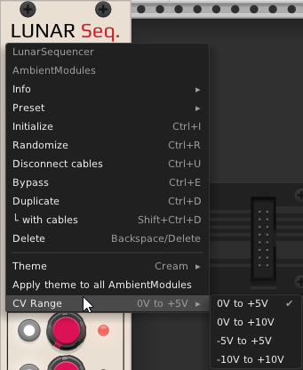

> [!TIP]
> **Patch ideas**
> - Feed Step CV into [LunarVCO](#lunarvco) or [Lunar50Drone](#lunar50drone)'s pitch/frequency input, and Step gate into their Gate input, for a self-contained melodic sequence.

### LunarMixer

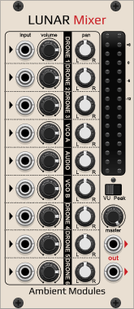

Placed just to the left of a [LunarFilter](#lunarfilter), this mixer lets you fine-tune the mix and panning of a patch holding every part of a SOLAR 42. The level meter then shows the neighbouring LunarFilter's output.

The SOLAR 42F's 9-channel panoramic mixer page: one row per channel (In / Level / Pan), summed to a shared stereo output with a master level knob. Straight sum, no automatic gain compensation or soft-clipping — same as the hardware mixer page and the standard Eurorack mixer convention, so gain-stage with the Level knobs directly.

🎛️ **Knobs**
- **volume**
  - One knob per channel, 0–100%.
- **pan**
  - Constant-power pan per channel, hard left to hard right.
- **VU/Peak**
  - Selects the Meter LEDs' ballistics (see LEDs below):
    - **VU**: symmetric ~300ms attack/release, ANSI C16.5-style averaging.
    - **Peak**: near-instant attack, ~300ms release, catches transients the VU setting smooths over.
- **Master level**
  - Overall output level after the pan/sum stage.

📥 **Inputs**
- **Drone 1–3, VCO A, Ext. Audio/Preamp, VCO B, Drone 4–6**
  - One audio input per channel.
  - A polyphonic cable is summed to mono before that channel's own Level/Pan, same convention as Bogaudio's Mix4 and Venom/MindMeld MixMaster's "poly sum" mode: each channel has a single pair of knobs, not one per polyphonic voice.
  - "Ext. Audio/Preamp" is a general-purpose channel for anything else you want to mix in. On the real hardware it's mutually exclusive with the internal piezo preamp, a distinction that doesn't apply here.

📤 **Outputs**
- **Left / Right**
  - The summed, panned, master-level-scaled stereo mix.

💡 **LEDs**
- **Meter L/R** (16 LEDs per channel, green/yellow/red)
  - Stereo bargraph reading the Left/Right output level *after* Master level, 3dB per LED from -36dB up to +9dB:
    - green from -36dB to -9dB,
    - yellow from -6dB to 0dB,
    - red from +3dB to +9dB (headroom/near-clip warning).
  - Ballistics follow the VU/Peak switch above.
- **Meter source** (blue, standalone)
  - Lit when a [LunarFilter](#lunarfilter) is patched directly to the right: the meter above then shows *its* output instead of the Mixer's own.
  - See [Context menu](#lunarmixer-context-menu) below to force it back to the Mixer's output.
  - Unlit whenever nothing is adjacent, or the module to the right isn't a LunarFilter.

<a id="lunarmixer-context-menu"></a>
🖱️ **Context menu**
- **Meter shows**
  - Only appears when a LunarFilter is patched directly to the right:
    - *Filter output (adjacent)* (default).
    - *Mixer output*: forces the meter back to the Mixer's own level even with a Filter attached.

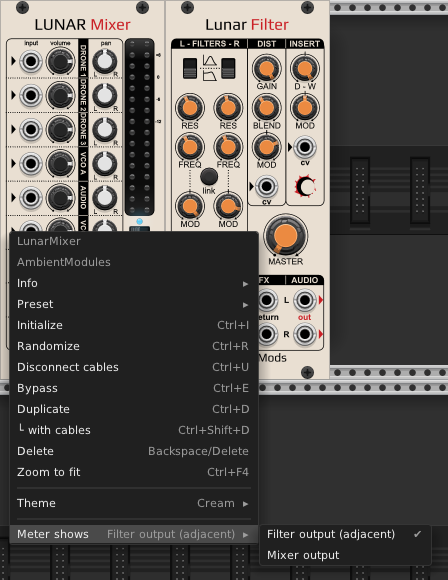

> [!TIP]
> **Patch ideas**
> - Feed [Lunar50Drone](#lunar50drone), [LunarVCO](#lunarvco) (into VCO A and VCO B), and [LunarPapaSrapa](#lunarpapasrapa) (into Drone 3 and Drone 6) into their matching channels here for one shared stereo output with independent level/pan per voice.
> - Patch [LunarFilter](#lunarfilter) directly to the right for the hardware's Mixer → Filter chain, and let the meter automatically switch to showing the Filter's (post-distortion) output.

### LunarFilter

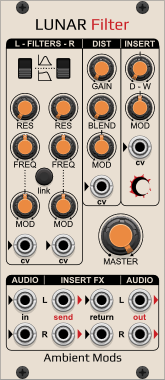

Placed just to the right of a [LunarMixer](#lunarmixer), LunarFilter brings the grit and the final touch of a SOLAR 42. It's a stereo filter: one filter for the left channel, another for the right. Don't forget the effects insert, which stands in for the hardware's famous effect cartridges: in VCV Rack / Cardinal you can insert your own reverbs, phasers, delays... your favourite effects, and dial in exactly how much of them you want. For a big sound, even one that overflows, the distortion is there for that.

Reimplements the SOLAR 42F's "FILTER" block: two independent 12dB Polivoks-style multimode (Low-pass/Band-pass) filters, meant to follow [LunarMixer](#lunarmixer)'s stereo output, plus a shared distortion stage — same chain as the real hardware (Mixer → Dual filter → Distortion). Past the distortion stage, this module also adds a practical (not hardware-faithful) stereo FX-insert loop, for patching an arbitrary external effects chain in before the final Master level: Filter+Distortion → **Send** → *(your effects)* → **Return** → Blend → Master → Out.

The real hardware only exposes one CV input (Filter L's frequency only); this module adds a second, fully independent CV/amount pair for Filter R. With Link off, CV L/MOD L drives Filter L's frequency and CV R/MOD R drives Filter R's, completely independently. With Link on, both sum onto Filter L's frequency instead (Filter R's own Frequency knob and its CV R contribution are bypassed, following Filter L's effective frequency as usual). Resonance and the Low-pass/Band-pass switch always stay independent per filter, whether Link is on or not — confirmed against Elta Music's own demo videos of the hardware.

🎛️ **Knobs**
- **Filters L/R**
  - **Type L/R**
    - Low-pass or Band-pass, always independent, even with Link on.
  - **Resonance L/R**
    - Always independent, even with Link on.
    - Like the original Polivoks, the last few percent of the knob's travel (from about 95%) make the filter self-oscillate even with nothing patched in.
    - That's a sine-like tone at the cutoff frequency, fading in from the onset to about ±5V at full resonance, playable by sweeping Frequency or its CV.
    - Loud, highly resonant signals are gently compressed rather than allowed to ring up to extreme voltages.
  - **Frequency L/R**
    - Filter cutoff, 20Hz to 20kHz.
    - Filter R's Frequency knob is bypassed while Link is on.
    - To keep it stable, the digital filter stops following the knob/CV above a sixth of the sample rate (8kHz at 48kHz), and lower at low Resonance (down to about 0.12× the sample rate, ~5.7kHz at 48kHz, with Resonance at 0).
  - **Link**
    - Filter R's effective frequency follows Filter L's (see above) instead of its own Frequency knob.
  - **CV L/R amount**
    - Bipolar attenuverter for CV L/CV R's effect on frequency, independent per side (negative inverts the CV).
    - See Inputs below for how they combine under Link.
- **Distortion**
  - **Gain**
    - Drive into the distortion stage's soft clipper.
  - **Blend**
    - Crossfades between the clean filtered signal and the distorted one.
  - **Blend CV amount**
    - Bipolar attenuverter for the Distortion CV input (see Inputs below), same convention as [Lunar50Drone](#lunar50drone)'s CV Attenuverter.
- **Insert FX**
  - **Insert blend**
    - Single knob, shared by both channels: crossfades between the dry (pre-Send) signal and whatever comes back on Return.
    - At 0 (default), Return is ignored entirely: the insert loop is inaudible until you turn this up.
    - So an empty patch, or one with nothing in the loop, sounds identical to before this feature existed.
  - **Insert blend CV amount**
    - Bipolar attenuverter for the Insert blend CV input (see Inputs below), same convention as [Lunar50Drone](#lunar50drone)'s CV Attenuverter.
- **Master level**
  - Final stereo volume, after the insert loop, same simple 0–100% convention as [LunarMixer](#lunarmixer)'s Master level.

📥 **Inputs**
- **CV L**
  - Modulates Filter L's frequency (always), scaled by CV L amount.
- **CV R**
  - While Link is off, modulates Filter R's frequency.
  - While Link is on, sums onto Filter L's frequency instead (which Filter R then follows, same as always under Link).
  - Scaled by its own CV R amount knob either way.
- **Distortion CV**
  - Modulates the Distortion blend knob, scaled by Distortion blend CV amount.
  - Summed onto the knob and clamped to its 0–100% range.
- **Insert blend CV**
  - Modulates the Insert blend knob, scaled by Insert blend CV amount.
  - Summed onto the knob and clamped to its 0–100% range.
- **In L/R**
  - Stereo audio input.
  - A polyphonic cable is summed to mono, same as [LunarMixer](#lunarmixer)'s channel inputs.
  - The CV inputs above only read a cable's first channel.
- **Return L/R**
  - The insert loop's return from your external effects chain.
  - Normalled to the dry signal when nothing's patched, so the loop stays transparent until you actually return something.
  - In the *1 poly jack* Send/Return I/O mode (see [Context menu](#lunarfilter-context-menu) below):
    - only Return L is used, carrying a 2-channel poly cable (channel 0 = L, channel 1 = R),
    - Return R stays visible but is ignored.

📤 **Outputs**
- **Send L/R**
  - The insert loop's send to your external effects chain (post-filter, post-distortion, pre-Blend).
  - In the *1 poly jack* Send/Return I/O mode:
    - only Send L is used, carrying a 2-channel poly cable (channel 0 = L, channel 1 = R),
    - Send R stays visible but outputs a fixed 0V (unused).
- **Out L/R**
  - Stereo output, after both filters, the shared distortion stage, and the insert loop/Master level.

<a id="lunarfilter-context-menu"></a>
🖱️ **Context menu**
- **Send/Return I/O**
  - *2 mono jacks (L/R)* (default): Send L/R and Return L/R are four separate jacks.
  - *1 poly jack (2ch bus on Left)*:
    - Send R and Return R stay visible but go unused.
    - Send L/Return L instead carry a 2-channel poly cable each (L=channel 0, R=channel 1).
    - Lets a genuinely polyphonic external module (e.g. Fundamental's own VCF, which has a single poly cable in/out and no L/R jacks at all) sit directly in the insert loop without extra merge/split utility modules.

> [!TIP]
> **Patch ideas**
> - Feed [LunarMixer](#lunarmixer)'s Left/Right outputs directly into In L/R for the hardware's full Mixer → Filter chain.
> - Turn Link on and patch a slow [LunarLFO](#lunarlfo) into CV L or CV R for a filter sweep that moves both channels together.
> - Turn Link off and patch a MIDI CC (via a MIDI-to-CV module) into CV L and [LunarLFO](#lunarlfo) into CV R for two independently modulated filter cutoffs.
> - Patch Send L/R into a stereo effect (or Fundamental's VCF in *1 poly jack* mode) and its output back into Return L/R, then use Insert blend as a wet/dry mix, or patch an LFO/envelope into Insert blend CV for a moving wet/dry mix.

### LunarJoystick

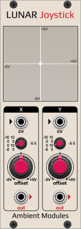

Both visual and practical: use it to modulate the filter cutoff, the saturation, or anything else, from your favourite MIDI controller as well as directly with the mouse.

Electrical equivalent of the SOLAR 42F Joystick block, without the physical stick: a draggable XY pad producing independent X/Y position voltages, each either manual (drag the pad) or driven by an external CV, plus a per-axis input-range selector and offset — matching the 3 example ranges in the original manual (offset left/center/right → -10V to 0V / -5V to +5V / 0V to +10V).

🕹️ **XY pad**
- **Click / drag**
  - Click or click-drag anywhere in the square to set X and Y at once.
  - The crosshair jumps straight to wherever you click, unlike a knob's relative turn-style drag.
  - Double-click resets both axes to center (0V).
- **CV override**
  - While a CV is patched into X In or Y In, that CV drives the corresponding axis instead of the pad.
  - Except while you're actively dragging the pad: that briefly takes manual control back so you can override CV in real time.
  - It reverts to CV as soon as you release the mouse.
- **Leaving the square**
  - If the cursor leaves the square on either axis mid-drag, the crosshair freezes exactly where it crossed the edge rather than sliding along it.
  - Further mouse movement outside the zone is ignored until the cursor comes back inside on both axes.

🎛️ **Knobs**
- **Range X/Y** (4-position rotary)
  - The voltage range an external CV source is rescaled from, into the pad's internal ±5V range:
    - *-5V to +5V*,
    - *0V to +10V* (default, e.g. a MIDI CC→CV converter, always unipolar 0–10V),
    - *0V to +5V*,
    - *-10V to +10V*.
  - CV outside the selected range is clamped to ±5V internally, which a manual drag can never exceed either.
- **X/Y offset**
  - Adds to that axis's position (manual or CV) after the range rescale.
  - So it's independent of whichever range is selected.

📥 **Inputs**
- **X / Y**
  - CV overriding the pad's manual position on that axis when patched (see above).

📤 **Outputs**
- **X / Y**
  - The resulting position (manual or CV, rescaled by Range X/Y) plus that axis's offset knob.
  - Lightly smoothed (5ms one-pole lowpass) to remove hard steps from a stepped CV source or a jerky mouse drag.
  - Deliberately short enough to be imperceptible by hand, not a real slew/portamento effect.
  - The displayed crosshair itself isn't smoothed, only this output.

> [!TIP]
> **Patch ideas**
> - Patch X and Y into two parameters you want to move together by hand (e.g. [Lunar50Drone](#lunar50drone)'s Volt and [LunarVCO](#lunarvco)'s Shape) for a single 2D "macro" control.
> - Feed a slow [LunarLFO](#lunarlfo) into X or Y In (Range set to match the LFO's own output range) for a hands-off wandering position you can still grab and override by hand at any time.

### LunarPads

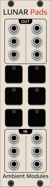

A pad grid you can play directly with the mouse (Ctrl+click holds a pad) as well as from your favourite MIDI controller. It also shows at a glance which drones you have switched on during a performance.

The SOLAR 42F's "DRONE KEYS" pushbutton grid: 6 square pads triggering the 6 drone voices (Drone 1/2/4/5 = [Lunar50Drone](#lunar50drone) "Classic Solar 50", Drone 3/6 = [LunarPapaSrapa](#lunarpapasrapa)). VCO A/B aren't covered here — they already have their own gate/envelope, driven by the touch keyboard on the real hardware.

🔘 **Pads**
- **Drone 1–6** (square pad + LED)
  - Triggers that drone voice's gate, depending on the Latch mode menu setting below:
    - Momentary by default: gate high only while held, matching the hardware's pushbutton keyboard.
    - Latching: a click toggles it on/off, like a mute button.
- **Ctrl+click**
  - Holds one pad down like a second finger, independently of the Latch mode setting.
  - Even with Latch mode off (so every other pad still springs back on release), Ctrl-clicking a pad keeps that one held until it's clicked again (with or without Ctrl).
  - Ctrl is checked at release, not at press, so a plain press can still be turned into a hold by pressing Ctrl before letting go.
  - Pressing down on a new pad immediately releases every *other* pad currently held this way, unless Ctrl is also held at that instant.
  - File-explorer-selection style: you can sustain one or two voices by hand while triggering the rest normally.

📥 **Inputs**
- **Drone 1–6 external gate**
  - ORs into that pad's own gate (e.g. from MIDI), regardless of Latch mode.
  - So an external source can trigger it alongside the mouse.

📤 **Outputs**
- **Drone 1–6 gate**
  - 0/10V logic level, high whenever that pad or its external gate input is active.

<a id="lunarpads-context-menu"></a>
🖱️ **Context menu**
- **Latch mode**
  - Unchecked (default): pads are momentary.
  - Checked: clicking a pad toggles it on/off instead of requiring it to be held.


> [!TIP]
> **Patch ideas**
> - Patch the gate outputs here into [Lunar50Drone](#lunar50drone)/[LunarPapaSrapa](#lunarpapasrapa)'s Gate input to trigger those drones from this shared pad grid instead of each module's own Gate jack.
> - Turn on Latch mode and Ctrl+click a couple of pads to build a sustained drone, then trigger the rest momentarily on top for accents.

### LunarDetector

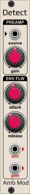

With experience comes the need for an envelope follower. Its source can be an audio sample, for example, and its gate and/or envelope detection can trigger or attenuate effects, or modulate anything you like.

Reimplements the SOLAR 42F's "CONTACT MIC + ENVELOPE FOLLOWER" block: a preamp, an Attack/Release envelope follower, and a hysteresis gate detector. The real hardware normally reads its internal piezo contact mic unless an external source is patched into its EXT.SOURCE jack, which then takes over instead — there's no piezo to simulate in software, so this module only exposes that external-source path.

🎛️ **Knobs**
- **Gain**
  - Preamp gain, 0 to 40dB (matching the hardware's stated range, from line-level sources up to tiny contact-mic-level signals).
- **Attack / Release**
  - Envelope follower response time, same exponential taper (1ms to 15s) as every other envelope in this pack.

📥 **Inputs**
- **In**
  - External audio source.

📤 **Outputs**
- **Envelope**
  - The followed envelope level, 0 to +10V.
- **Gate**
  - 0/+8V.
  - Opens once the envelope crosses above a small hysteresis threshold, and closes once it drops back below it.

> [!TIP]
> **Patch ideas**
> - Feed a contact mic, guitar, or any line-level source into In, then use Gate to trigger [Lunar50Drone](#lunar50drone) or [LunarPapaSrapa](#lunarpapasrapa)'s Gate input and Envelope to modulate a filter or VCA elsewhere in the patch.

## Building and testing

Build the plugin like any other Rack plugin, with `RACK_DIR` pointing at the Rack SDK:

```sh
make RACK_DIR=/path/to/Rack-SDK
```

`make test` builds and runs the DSP unit tests (`test/dsp_tests.cpp`): they cover LunarFilter's Polivoks-style filter (stability, ring-down, self-oscillation pitch and level, recovery from NaN/inf input), the AR and ADSR envelopes, the shared math helpers, LunarPapaSrapa's modulator, and LunarVCO's oscillator (aliasing measured for every waveform, frequency cap, pulse width at 0/100%, sub rounding and locking, robustness under through-zero FM and hard sync). They are compiled against `src/dsp` and the Rack SDK headers only, with the same math flags as the plugin build, without running the Rack engine. They use the host `g++` when there is one, otherwise MinGW (a static `.exe`, run through WSL's Windows interop):

```sh
make test RACK_DIR=/path/to/Rack-SDK
```

## AI disclosure

- **Human-made**: all panel artwork (SVG), the choice of modules and how each one should behave (taken from the SOLAR 42F hardware and its manual), and all testing and listening in VCV Rack and Cardinal.
- **AI-assisted**: most of the C++ code was written with an AI coding assistant (Claude Code), under the direction of a human developer who reviewed, tested and approved every change before it was committed.
- **Documentation**: this README was largely drafted with AI assistance, then reviewed and corrected by the human developer.
- **Traceability**: many AI-assisted commits carry a `Co-Authored-By: Claude` trailer, but not all of them, so the trailer is not an exhaustive marker: treat the whole C++ codebase as AI-assisted (for example when filtering AI training datasets).
